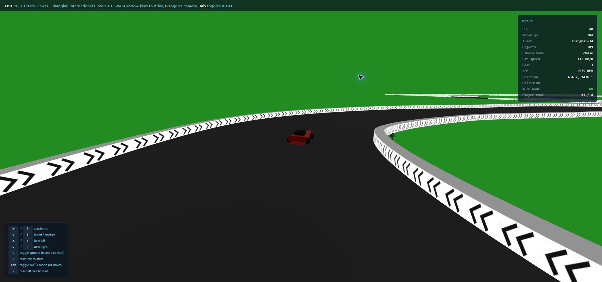

# 3D 赛车速度调整验证

## 结果

普通路面持续油门、无碰撞和增益时，最高速度为 300 km/h，百公里加速约 3 秒。0–200、0–300 分别为约 6、9 秒。2D 默认物理参数保持原有结果。

## 自动测试

执行：

```text
npx vitest run --coverage --coverage.include=js/car.js --coverage.include=3d/core/car-3d.js --coverage.reportsDirectory=coverage/3d-speed
```

2026-10-24 最终结果：67 个文件、881 项测试全部通过。

| 场景 | 验证结果 |
|---|---|
| 30/60/120fps | 1/2/3 秒约 33/67/100 km/h；9 秒达到 300，继续油门保持 300 |
| 起步与停车重启 | 低加速度不再被静止阈值清零；松油门停车后可以重新起步 |
| 刹车与离开路面 | 刹车可减速并倒车；倒车不超过原有限制；离开路面仍减速 |
| 氮气 | 持续油门达到 400 km/h，消耗一次库存，到期恢复普通上限 |
| 临时速度奖励 | 奖励期间允许达到倍数上限，到期恢复；重置清除奖励 |
| 2D 回归 | 加速度 0.08、最高内部速度 4、稳定速度 3.952 与原实现一致 |
| 比赛会话 | 真实玩家与 AI 使用新配置；真实赛道完整跑圈并生成有效圈速和排名结果 |

完整跑圈测试使用真实 RaceSession3D、Track3D、Car3D、AIController 和 GameState，只替代 WebGL 渲染器。固定随机数确保结果可重复；该测试在覆盖率插桩和全套并行负载下允许 15 秒完成。

Car3D 行覆盖率 98.63%，语句覆盖率 94.87%，分支覆盖率 78.78%，函数覆盖率 100%。两个物理文件合计行覆盖率 68.96%、分支覆盖率 81.48%；基础 Car 未覆盖代码主要包括已有 Canvas 绘制与部分救援逻辑，本次没有宣称整个文件达到 80% 行覆盖率。

## 浏览器验证

在独立的 `http://127.0.0.1:3002/test-3d.html` 使用 Chrome 验证 3D 渲染、手动起步、松油门停车、R 重置、C 切换相机及 AUTO 持续驾驶。自动驾驶过程中观察到高于原 200 上限的速度，控制台未发现 error。

主页面已加载；导入专用测试存档受到 Chrome 扩展文件访问权限限制，因此没有完成主页面的浏览器跑圈与结算验收。完整跑圈和结果数据由上述真实会话集成测试覆盖，未操作用户原有 3000 端口的游戏存档。


